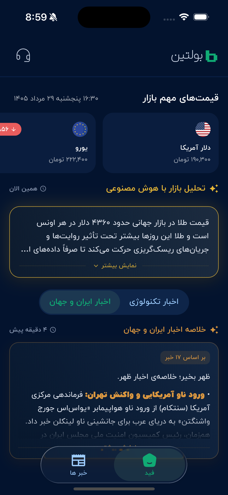

<p align="center">
  
</p>

<h1 align="center">Boltin</h1>

<p align="center">
  <strong>نبض بازار و خبر</strong><br>
  Live market prices and AI news briefs, in one glance.
</p>

<p align="center">
  
  
  
  
</p>

<p align="center">
  A production Flutter client for Iranian users who want FX, gold, and crypto
  rates next to short AI summaries — without signing up or switching apps.
</p>

---

## Why it exists

Checking the market in Iran usually means bouncing between websites, apps, and
Telegram channels. Boltin collapses that into a single feed:

- Important FX, gold, and crypto prices, refreshed quietly every minute
- An AI market brief
- Collapsible AI news summaries for Iran & world, and technology
- Optional in-app feedback, anonymous analytics, and forced or optional updates

The home screen above is the product: dark terminal-inspired UI, RTL Persian
typography, and only the numbers and briefs you need for the next two minutes.

## Features

| Area | What ships |
| --- | --- |
| Market | Horizontal cards for key assets, plus a full list grouped by FX / gold / crypto |
| AI | Latest geopolitics and technology summaries, rendered as Markdown |
| Analysis | Expandable market brief with relative Persian timestamps |
| Launch | Custom HUD splash, parallel bootstrap, retry on failure |
| Ops | Optional and forced updates, 30s foreground analytics ping, feedback form |
| UX | RTL, IRANYekan, Persian digits, shimmer and error states, liquid-glass tabs |

## Architecture

```
lib/
  api/          Base URL and endpoint paths
  models/       Typed JSON (snapshot, summaries, analysis, update)
  services/     HTTP clients with injectable `http.Client`
  screen/       Splash, home feed, all prices, news placeholder
  widget/       Price cards, AI cards, dialogs, icons
  utils/        Persian number and relative-time formatting
```

On launch the splash fans out five requests in parallel (18s timeout each):

1. **Snapshot** — required. If prices fail, the user stays on splash with retry.
2. **Summaries** — optional.
3. **Market analysis** — optional.
4. **Update check** — optional unless `force_update` is true.
5. **Analytics ping** — best-effort.

After entry, the feed polls silently every minute and keeps the last good data
if a request fails. App lifecycle stops the analytics heartbeat in the
background and avoids treating system sheets as an app exit.

## Stack

- Flutter / Dart 3.11
- `http` for REST, Hive for a stable anonymous device id
- Custom `CustomPainter` splash (radar mark + candlestick backdrop)
- Markdown rendering for AI copy
- Android `MethodChannel` to open the store / APK URL

## Getting started

```bash
flutter pub get
flutter run
```

Requirements: Flutter 3.11+, Android API 24+ (or an iOS simulator).

Release signing keys stay local. Copy `android/key.properties.example` to
`android/key.properties` and point it at your keystore; those files are
gitignored.

```bash
flutter test
```

Unit tests cover JSON models, URL building, Persian formatting, HTTP services
(with `package:http/testing.dart`), and the main feed widgets.

## Product notes

Boltin is designed as a daily companion, not a newsreader. Prices come from a
backend snapshot API. AI copy is produced server-side from selected channels
and market data, then shown as short briefs — morning, noon, and night in the
store listing, live-polled in the current client.

The news tab is intentionally a placeholder; the feed already carries the
summaries that matter for v1.
